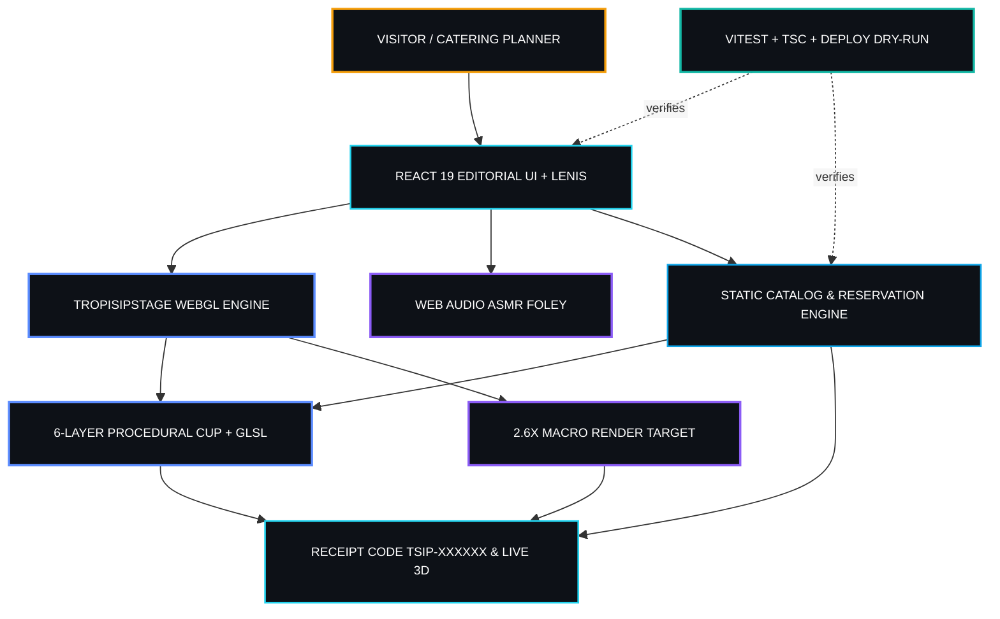

<table width="100%">
<tr>
<td width="34%" align="center" valign="middle">

<a href="#01--origin-signal">
  
</a>
<br /><br />
<small><b><code>TROPISIP</code></b></small><br />
<small>Procedural 3D Editorial Beverage Showcase</small><br /><br />


</td>
<td width="66%" valign="top">

SENTRA / TROPISIP

<a href="#01--origin-signal">
  
</a>

<b>Operational signal:</b> Local Vite SPA (`127.0.0.1:4180`) · 100% procedural WebGL showcase with zero external runtime assets

<a href="https://sentrahai.com/"><b>Sentra Artificial Intelligence</b></a><br />
Interactive 3D tropical editorial landing page and client-side order/catering reservation studio for Tropisip cold-pressed fruit juices.

<small>Owned by <b>dr. Ferdi Iskandar (Gaffer)</b> · Website built &amp; animated by <b>dr. Novia DA — Sentra Mitra Design</b>.</small>

<sub><code>SCROLL / FLAVOR INPUT → PROCEDURAL 3D + AUDIO ENGINE → STATIC &amp; BROWSER VERIFICATION → HUMAN AUTHORITY → STATIC RELEASE</code></sub>

</td>
</tr>
</table>

## 01 / Origin Signal

Tropisip (`projects/corporate/tropisip`) is a sovereign SAFRS corporate product capsule delivering a sun-drenched, Bahasa Indonesia editorial 3D product experience for Tropisip ("Good Juice, Good Vibes"). Rather than relying on heavy video loops, third-party CDN fonts, or external 3D `.glb` / `.hdr` / `.mp3` downloads, every visual and sonic artifact—from the sunlit studio HDRI and silkscreened cup emblem to the 420+ refractive condensation droplets, dynamic subsurface-scattered fruit pulp, 2.6× WebGL optical macro lens, and scroll-reactive ASMR foley—is synthesized procedurally in the browser.

The showcase presents all six official Tropisip menu variants (**Jus Mangga**, **Jus Alpukat** with vertical chocolate wall-drizzles, **Jus Buah Naga**, **Jus Jambu**, **Jus Semangka**, and **Jus Melon**) at transparent everyday pricing (`16oz Rp 7.000` / `22oz Rp 10.000`), paired with a 6-layer Lenis scroll explosion, nutrition comparison sheet, and client-side Quick Order / Event Catering reservation calculator.

- **Intended users:** Retail beverage customers exploring Tropisip flavors, event/office catering planners estimating 25+ cup packages, and internal Sentra/Tropisip operators maintaining or deploying the static site.
- **In scope:** Interactive 3D product inspection, 6-flavor live material/chunk morphing, 16oz/22oz cup scaling and nutrition specs, Web Audio ASMR foley, client-side order & catering validation/receipt generation (`TSIP-XXXXXX`).
- **Out of scope:** Payment processing, backend order persistence, SMS/WhatsApp dispatch automation, user authentication, or live CDN deployment without explicit human approval.

<p align="center">
  
  
  
</p>

<table width="100%">
<tr>
<td width="33%" valign="top">

<small><b><code>LAYER I · PROCEDURAL 3D STAGE</code></b></small><br />
<small>Three.js WebGL2 renderer with procedural FloatType sunlit HDRI, 6 scroll-exploded layers, GLSL SSS pulp &amp; dew shaders, and 2.6× secondary macro camera.</small>

</td>
<td width="33%" valign="top">

<small><b><code>LAYER II · EDITORIAL UI &amp; LENIS</code></b></small><br />
<small>React 19 + TypeScript + Lenis smooth scroll with Classic Linen (#FAF6ED), vibrant Orange/Cyan CTAs, self-hosted Poppins/JetBrains Mono, and ref-driven transient updates.</small>

</td>
<td width="33%" valign="top">

<small><b><code>LAYER III · FOLEY &amp; RESERVATION</code></b></small><br />
<small>Procedural Web Audio API pour/bubble/ice-clink synthesizer and pure deterministic pricing/validation engine for 16oz/22oz quick orders and 25+ cup catering.</small>

</td>
</tr>
</table>

See [docs/product/PRODUCT_SCOPE.md](docs/product/PRODUCT_SCOPE.md) for the complete user workflow, requirement matrix, and known boundaries.

## 02 / Doctrine

> [!IMPORTANT]
> **100% Procedural Craft · Zero External Runtime Dependencies · Zero Hardcoded PII.** Every runtime asset is generated deterministically in code or bundled locally via Vite; local poster references under `sources/` remain gitignored and excluded from `src/` and `dist/`.

<table width="100%">
<tr>
<td width="50%" valign="top">

<small><b><code>CAPSULE SOVEREIGNTY</code></b></small><br />
<small>Self-contained workspace (`package.json`, `pnpm-workspace.yaml`, `pnpm-lock.yaml`, `project.contract.json`) with zero runtime or build coupling to monorepo root packages.</small>

</td>
<td width="50%" valign="top">

<small><b><code>ZERO-ASSET COMPLIANCE</code></b></small><br />
<small>Automated Vitest checks in `tests/tropisip.test.ts` fail if external HTTP asset URLs or real phone number patterns appear in `index.html` or `src/`.</small>

</td>
</tr>
<tr>
<td width="50%" valign="top">

<small><b><code>TRANSIENT STATE DISCIPLINE</code></b></small><br />
<small>High-frequency scroll and pointer coordinates stay in refs and Three.js scratch vectors—avoiding 60–120Hz React re-renders and per-frame GC pressure.</small>

</td>
<td width="50%" valign="top">

<small><b><code>NO MAGIC WITHOUT AUDIT</code></b></small><br />
<small>Every build, test, visual audit, and documentation gate records exact observed outputs and explicitly marks NOT RUN or blocked checks.</small>

</td>
</tr>
</table>

## 03 / Product Topology

<details open>
<summary><b><code>LIVE TOPOLOGY // SYSTEM RELATION MAP</code></b></summary>



</details>

### Component Map

<table width="100%">
<tr>
<td width="50%" valign="top">

<small><b><code>01 · src/three/</code></b></small><br />
<small><b>Procedural WebGL Studio Engine</b></small><br />
<small>`TropisipStage.ts`, `cupAssembly.ts`, `kinematics.ts`, `proceduralHdri.ts`, `proceduralTextures.ts` — HDRI probe, 6-layer cup geometry, GLSL SSS/dew/softbox shaders, and 2.6× macro render pass.</small><br />
<sub>Verified · Browser WebGL2</sub>

</td>
<td width="50%" valign="top">

<small><b><code>02 · src/components/ &amp; src/App.tsx</code></b></small><br />
<small><b>Editorial React 19 UI Surface</b></small><br />
<small>`TopBar`, `StageCanvas`, `LayerRail`, `NutritionSpecs`, `OrderCateringForm`, `TropisipWordmark` — memoized sections orchestrated over Lenis smooth scroll.</small><br />
<sub>Verified · Browser + TypeScript strict</sub>

</td>
</tr>
<tr>
<td width="50%" valign="top">

<small><b><code>03 · src/audio/foleyEngine.ts</code></b></small><br />
<small><b>Procedural Web Audio Synthesizer</b></small><br />
<small>Synthesizes scroll-velocity pink-noise juice pours, bubble pops, modal crystal ice clinks, and tactile dome snaps without audio sample files.</small><br />
<sub>Verified · Browser opt-in toggle</sub>

</td>
<td width="50%" valign="top">

<small><b><code>04 · src/data/ &amp; src/lib/</code></b></small><br />
<small><b>Catalog &amp; Reservation Domain Logic</b></small><br />
<small>6-flavor menu specs (`flavors.ts`), 6-layer metadata + `LAYER_BY_KEY` map (`layers.ts`), IDR pricing, catering discount tiers, and FNV-1a receipt codes (`reservation.ts`).</small><br />
<sub>Verified · Vitest 8/8 passing</sub>

</td>
</tr>
</table>

### Capability Matrix

| Capability | Status | Evidence | Boundary |
|---|---|---|---|
| 6-layer scroll-exploded 3D cup | Verified | `src/three/cupAssembly.ts`, `src/three/kinematics.ts`, `tests/tropisip.test.ts` | Client WebGL2; degrades to text fallback if WebGL disabled |
| 6 live flavors (`Rp 7.000` / `Rp 10.000`) | Verified | `src/data/flavors.ts`, browser audit (`127.0.0.1:4180`) | Static catalog; price edits require source change & rebuild |
| 2.6× WebGL optical macro lens | Verified | `src/three/TropisipStage.ts`, `src/components/StageCanvas.tsx` | Offscreen `384×384` `WebGLRenderTarget` with raycast telemetry |
| Web Audio ASMR scroll foley | Verified | `src/audio/foleyEngine.ts`, browser toggle audit | Requires explicit user gesture to satisfy browser autoplay policy |
| Quick order & 25+ catering form | Verified | `src/components/OrderCateringForm.tsx`, `src/lib/reservation.ts` | Client-side validation & receipt only; no backend order persistence |
| Static production build & dry-run | Verified | `vite.config.ts`, `scripts/deploy-dry-run.mjs`, `dist/index.html` | No live hosting provider configured yet |

## 04 / The Engine Room

Full component internals and rendering boundaries are documented in [docs/architecture/ARCHITECTURE.md](docs/architecture/ARCHITECTURE.md) and [docs/architecture/DECISIONS.md](docs/architecture/DECISIONS.md).

### Repository Anatomy

```text
projects/corporate/tropisip/
├── .agents/                  # Capsule-local HANDOFF, CONTEXT, DECISIONS
├── docs/                     # SRDS-FULL v1.2 documentation suite & manifest
│   ├── architecture/         # ARCHITECTURE.md, DECISIONS.md
│   ├── assets/               # tropisip-mark.svg (local README emblem)
│   ├── engineering/          # DEVELOPMENT.md, TESTING.md, VERIFICATION.md
│   ├── governance/           # BOUNDARIES.md
│   ├── operations/           # RUNBOOK.md, TROUBLESHOOTING.md, DEPLOYMENT.md
│   ├── product/              # PRODUCT_SCOPE.md
│   ├── security/             # SECURITY.md
│   └── documentation.manifest.json
├── scripts/                  # deploy-dry-run.mjs
├── sources/                  # Gitignored local brand references (never bundled)
├── src/
│   ├── audio/                # foleyEngine.ts (procedural Web Audio)
│   ├── components/           # Memoized React 19 UI components
│   ├── data/                 # flavors.ts (6 menu items), layers.ts (6 layers)
│   ├── lib/                  # reservation.ts (pricing, validation, TSIP codes)
│   ├── styles/               # editorial.css (Classic Linen + Orange/Cyan CTAs)
│   ├── three/                # WebGL stage, cup assembly, shaders, HDRI, textures
│   ├── App.tsx
│   └── main.tsx
├── tests/                    # tropisip.test.ts (Vitest suite)
├── AGENTS.md                 # Capsule agent routing & boundaries
├── CHANGELOG.md              # Verified version history
├── index.html                # Offline-ready HTML entrypoint (lang="id")
├── package.json              # Capsule dependencies & npm scripts
├── pnpm-lock.yaml            # Capsule-local lockfile
├── pnpm-workspace.yaml       # Isolates capsule from monorepo workspace
├── project.contract.json     # SAFRS capsule lifecycle contract
├── tsconfig.json             # Strict TypeScript 5.9 compiler config
├── vite.config.ts            # Vite 6 bundler & chunk split config
└── vitest.config.ts          # Vitest 3 node test runner config
```

## 05 / Build Protocol

### Prerequisites

- **Node.js**: `>=24` (verified on `v24.21.0`)
- **pnpm**: `11.21.0` / `12.x` (capsule carries its own `pnpm-workspace.yaml` and `pnpm-lock.yaml`)

### Installation & Local Run

```bash
pnpm install --frozen-lockfile
pnpm run dev
```

Development and preview servers bind to `http://127.0.0.1:4180/`. No environment variables or `.env` files are required.

### Verification Commands

```bash
pnpm run typecheck
pnpm run test
pnpm run build
pnpm run deploy:dry-run
```

See [docs/engineering/DEVELOPMENT.md](docs/engineering/DEVELOPMENT.md), [docs/engineering/TESTING.md](docs/engineering/TESTING.md), and [docs/engineering/VERIFICATION.md](docs/engineering/VERIFICATION.md) for full reproduction details and test coverage boundaries.

## 06 / Security, Operations & Governance

- **Security & Privacy** ([docs/security/SECURITY.md](docs/security/SECURITY.md)): Zero backend secrets, zero authentication surface, zero external runtime network requests, and automated static PII guards preventing poster phone numbers in gitignored `sources/` from leaking into tracked code.
- **Operations & Troubleshooting** ([docs/operations/RUNBOOK.md](docs/operations/RUNBOOK.md), [docs/operations/TROUBLESHOOTING.md](docs/operations/TROUBLESHOOTING.md), [docs/operations/DEPLOYMENT.md](docs/operations/DEPLOYMENT.md)): Local dev/preview lifecycle, WebGL/Web Audio recovery diagnostics, and static artifact promotion boundaries.
- **SAFRS Governance** ([docs/governance/BOUNDARIES.md](docs/governance/BOUNDARIES.md), [AGENTS.md](AGENTS.md)): Default risk tier `R1`, explicit human approval required for merge, push, or live deployment (`R2`/`R3`).

## 07 / Verification Status

| Gate | Command | Status | Notes |
|---|---|---|---|
| Typecheck | `pnpm run typecheck` | PASS | `tsc --noEmit` — 0 errors (2026-11-22) |
| Unit & static compliance tests | `pnpm run test` | PASS | `8/8` tests in `tests/tropisip.test.ts` (2026-11-22) |
| Production build | `pnpm run build` | PASS | Vite 6 bundle + self-hosted fonts in `dist/` (2026-11-22) |
| Deploy dry-run | `pnpm run deploy:dry-run` | PASS | Validates `dist/index.html` exists without external side effects |
| Live browser visual audit | `http://127.0.0.1:4180/` | PASS | 0 console errors, 0 page errors, 0 external network requests |
| Capsule lint contract (`srds_audit.py`) | `project.contract.json#commands.lint` | OPEN / ESCALATED | Uses SAFRS `notApplicableReason`; `srds_audit.py` requires an executable `lint` command |
| Empirical SAFRS extraction | `pnpm project:verify corporate/tropisip` | NOT RUN | Capsule awaits git registration and human-approved extraction check |

See [CHANGELOG.md](CHANGELOG.md) for release notes and [docs/documentation.manifest.json](docs/documentation.manifest.json) for the machine-checkable SRDS-FULL v1.2 inventory.
