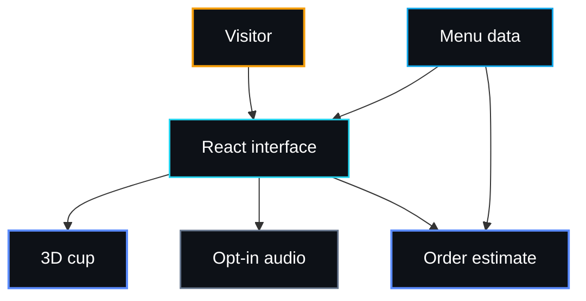
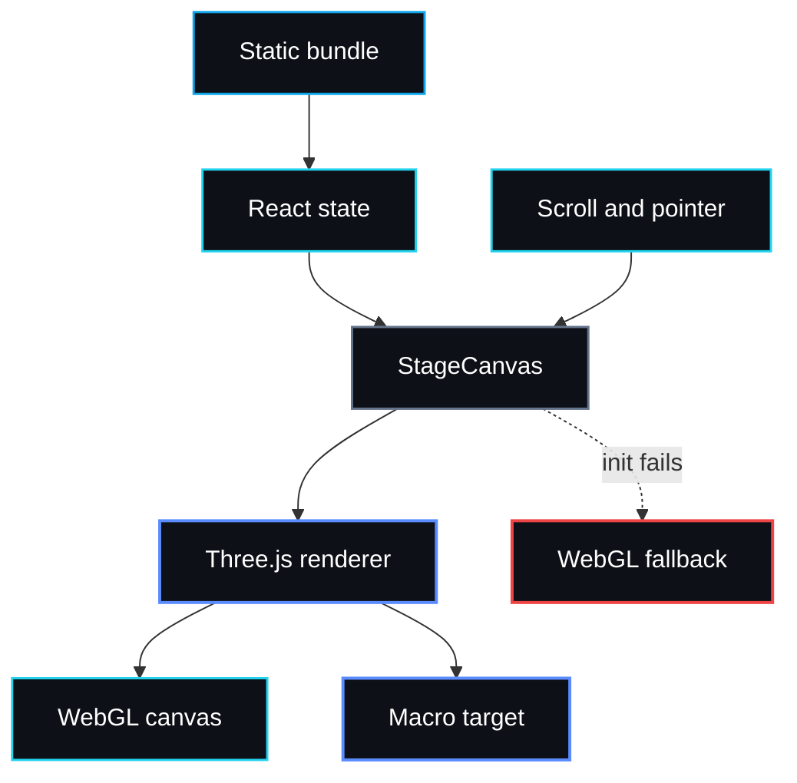
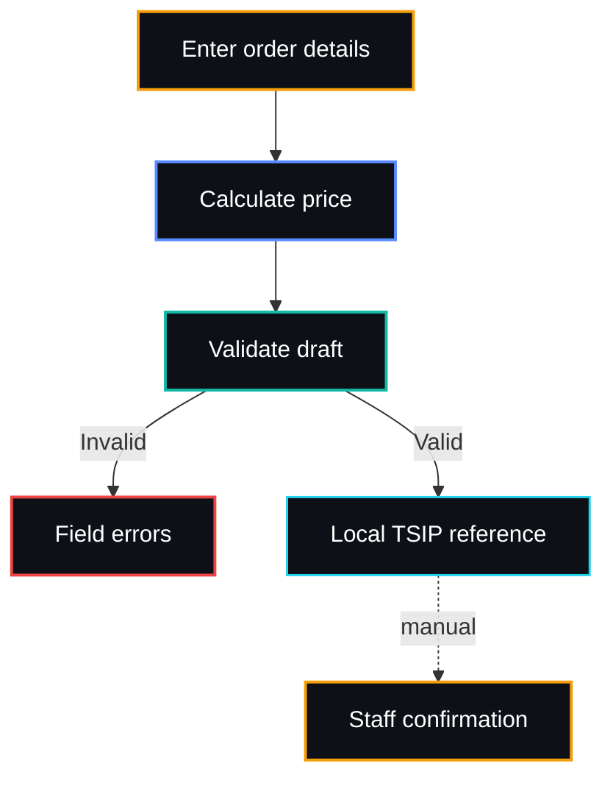
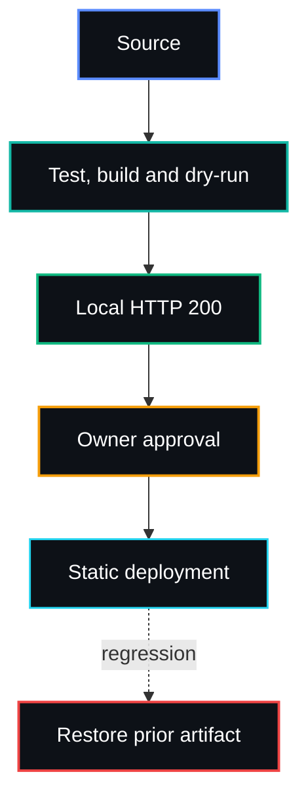

<table width="100%">
<tr>
<td width="34%" align="center" valign="middle">

<a href="https://github.com/gaffercode/Tropisipjuice">
  
</a>
<br /><br />
<small><b><code>TROPISIP</code></b></small><br />
<small>Interactive 3D juice showcase</small><br /><br />


</td>
<td width="66%" valign="top">

<small><b><code>SENTRA / TROPISIP</code></b></small><br /><br />

<a href="https://github.com/gaffercode/Tropisipjuice">
  
</a><br /><br />

<small><b>Operational signal</b> · Static browser application · Procedural 3D and local order estimates</small><br /><br />

<small><a href="https://sentrahai.com/"><b>Sentra Artificial Intelligence</b></a></small><br />
<small>Explore six Tropisip juices in a 3D cup and estimate a quick order or event catering in Bahasa Indonesia.</small><br /><br />

<small>A collaboration between <b>dr. Ferdi Iskandar (the Gaffer)</b> and <b>dr. Novia DA of Sentra Mitra Design</b>.</small>

<p>
  <a href="https://github.com/gaffercode/Tropisipjuice" title="GitHub"></a>&nbsp;&nbsp;
  <a href="https://ferdiiskandar.com" title="ferdiiskandar.com"></a>&nbsp;&nbsp;
  <a href="https://sentrahai.com/" title="Sentra Artificial Intelligence"></a>&nbsp;&nbsp;
  <a href="https://medium.com/@drferdiiskandar" title="Medium"></a>&nbsp;&nbsp;
  <a href="https://orcid.org/0009-0003-3788-1307" title="ORCID"></a>&nbsp;&nbsp;
  <a href="https://www.linkedin.com/in/dr-ferdi-iskandar-1b620a3b5"></a>
</p>

<sub><code>VISITOR INPUT → BROWSER PROCESSING → LOCAL VALIDATION / RELEASE CHECKS → HUMAN AUTHORITY → ORDER CONFIRMATION / RELEASE</code></sub>

</td>
</tr>
</table>

## 01 / ORIGIN SIGNAL

Tropisip brings the counter menu into a Bahasa Indonesia product showcase. Visitors can inspect the cup, compare serving sizes and nutrition information, and estimate quantities and prices before arranging a purchase or catering booking with Tropisip staff. The catalog contains **Jus Mangga**, **Jus Alpukat**, **Jus Buah Naga**, **Jus Jambu**, **Jus Semangka**, and **Jus Melon**, each listed at **Rp 7.000 for 16 oz** or **Rp 10.000 for 22 oz**.

- **Intended users** include retail visitors, event planners and the Tropisip maintainers who update the catalog and approve releases.
- **Scope** covers the interactive cup, six-layer scroll exploration, optional 2.6× loupe and synthesized audio, static menu information, and local order and catering estimates.
- **Outside scope** includes inventory, payment, order dispatch, email delivery, accounts and booking persistence. A staff member must confirm any actual booking.

The repository contains the static web application, capsule lifecycle contract and operator documentation. See the [product scope](docs/product/PRODUCT_SCOPE.md) and [menu catalog](src/data/flavors.ts).

<p align="center">
  
  
  
</p>

<table width="100%">
<tr>
<td width="33%" valign="top">
<small><b><code>LAYER I · 3D STUDIO</code></b></small><br />
<small>Three.js renders the procedural cup, lighting, condensation, fruit textures and macro view.</small>
</td>
<td width="33%" valign="top">
<small><b><code>LAYER II · EDITORIAL UI</code></b></small><br />
<small>React and Lenis connect scroll and flavor selection to the cup, layer rail and nutrition panels.</small>
</td>
<td width="33%" valign="top">
<small><b><code>LAYER III · ESTIMATES &amp; AUDIO</code></b></small><br />
<small>Browser-side pricing calculates quick orders and catering. Opt-in Web Audio synthesizes the foley.</small>
</td>
</tr>
</table>

## 02 / DOCTRINE

> [!IMPORTANT]
> Generate the 3D scene and audio in the browser, bundle fonts with the site, and keep local brand references outside the build.

<table width="100%">
<tr>
<td width="50%" valign="top">
<small><b><code>CAPSULE SOVEREIGNTY</code></b></small><br />
<small>The capsule owns its manifest, lockfile, workspace configuration and lifecycle commands.</small>
</td>
<td width="50%" valign="top">
<small><b><code>RUNTIME ASSETS</code></b></small><br />
<small>The browser receives the static bundle and generates the scene without third-party asset URLs in application source.</small>
</td>
</tr>
<tr>
<td width="50%" valign="top">
<small><b><code>TRANSIENT STATE</code></b></small><br />
<small>Scroll progress and pointer motion travel through refs. React state holds discrete UI selections and form inputs.</small>
</td>
<td width="50%" valign="top">
<small><b><code>PRIVACY FENCE</code></b></small><br />
<small>Local references under <code>sources/</code> are gitignored. Static tests check runtime source for external URLs and Indonesian phone-number patterns.</small>
</td>
</tr>
<tr>
<td width="50%" valign="top">
<small><b><code>ONE PROBLEM, THEN DEPTH</code></b></small><br />
<small>Help visitors inspect and price the menu before coordinating a purchase or event.</small>
</td>
<td width="50%" valign="top">
<small><b><code>NO MAGIC WITHOUT AUDIT</code></b></small><br />
<small>Tie runtime claims to source and checks. Require owner approval for production promotion.</small>
</td>
</tr>
</table>

## 03 / PRODUCT TOPOLOGY

<p align="center">
  
  
  
  
</p>

<details open>
<summary><b><code>LIVE TOPOLOGY // SYSTEM RELATION MAP</code></b></summary>



</details>

### Component map

<table width="100%">
<tr>
<td width="50%" valign="top">
<small><b><code>01 · 3D STAGE</code></b></small><br />
<small><a href="src/three/TropisipStage.ts">TropisipStage</a> manages rendering, cameras and scene lifecycle. <a href="src/three/cupAssembly.ts">Cup assembly</a> builds geometry and GLSL materials.</small>
</td>
<td width="50%" valign="top">
<small><b><code>02 · EDITORIAL SURFACE</code></b></small><br />
<small><a href="src/App.tsx">App</a> handles flavor, size and scroll and coordinates stage, layer rail, nutrition and form components.</small>
</td>
</tr>
<tr>
<td width="50%" valign="top">
<small><b><code>03 · FOLEY</code></b></small><br />
<small><a href="src/audio/foleyEngine.ts">Foley engine</a> uses procedural noise and tone synthesis for pour, bubble, ice and lid sounds.</small>
</td>
<td width="50%" valign="top">
<small><b><code>04 · PRICING &amp; VALIDATION</code></b></small><br />
<small><a href="src/lib/reservation.ts">Reservation logic</a> calculates prices, validates draft fields and generates a reference code in memory.</small>
</td>
</tr>
</table>

### Capability matrix

<table width="100%">
<thead>
<tr>
<th align="left"><small>Capability</small></th>
<th align="left"><small>Status</small></th>
<th align="left"><small>Repository evidence</small></th>
<th align="left"><small>Boundary</small></th>
</tr>
</thead>
<tbody>
<tr>
<td><small>Six flavors and two sizes</small></td>
<td><small>VERIFIED</small></td>
<td><small><a href="tests/tropisip.test.ts">Vitest catalog assertions</a></small></td>
<td><small>Prices come from the static catalog.</small></td>
</tr>
<tr>
<td><small>Six-layer movement</small></td>
<td><small>VERIFIED</small></td>
<td><small><a href="tests/tropisip.test.ts">Vitest kinematics assertions</a></small></td>
<td><small>Tests cover calculation. Browser rendering evidence is recorded separately.</small></td>
</tr>
<tr>
<td><small>2.6× macro loupe</small></td>
<td><small>IMPLEMENTED</small></td>
<td><small><a href="src/three/TropisipStage.ts">Macro camera and 384×384 render target</a></small></td>
<td><small>Requires a working WebGL context and user activation.</small></td>
</tr>
<tr>
<td><small>Synthesized audio</small></td>
<td><small>IMPLEMENTED</small></td>
<td><small><a href="src/audio/foleyEngine.ts">Foley engine</a></small></td>
<td><small>Starts after user opt-in.</small></td>
</tr>
<tr>
<td><small>Quick order and catering estimate</small></td>
<td><small>VERIFIED</small></td>
<td><small><a href="tests/tropisip.test.ts">Pricing, validation and code assertions</a></small></td>
<td><small>Local reference only. Staff confirm actual orders.</small></td>
</tr>
<tr>
<td><small>Static bundle and artifact check</small></td>
<td><small>VERIFIED</small></td>
<td><small><a href="scripts/deploy-dry-run.mjs">Artifact existence check</a></small></td>
<td><small>Local build and dry-run only.</small></td>
</tr>
</tbody>
</table>

## 04 / THE ENGINE ROOM

<table width="100%">
<tr>
<td width="33%" valign="top">
<small><b><code>ENTRY &amp; STATE</code></b></small><br />
<small>Vite serves <code>index.html</code>. <code>src/main.tsx</code> mounts React and imports bundled font styles.</small>
</td>
<td width="33%" valign="top">
<small><b><code>VISUAL PIPELINE</code></b></small><br />
<small><code>StageCanvas</code> owns canvas lifecycle. The stage generates studio lighting, textures and the main and macro renders.</small>
</td>
<td width="33%" valign="top">
<small><b><code>INPUT HANDLING</code></b></small><br />
<small>Lenis supplies the scroll update loop. Native pointer events drive the macro position through refs.</small>
</td>
</tr>
</table>

<details open>
<summary><b><code>RUNTIME TOPOLOGY // BROWSER RENDER PATH</code></b></summary>



</details>

### Repository anatomy

```text
.
├── .agents/                  # Capsule context, decisions and handoff
├── docs/                     # Architecture, operations, product, security and logo
├── scripts/deploy-dry-run.mjs
├── src/
│   ├── App.tsx               # Browser interaction and page composition
│   ├── main.tsx              # React entrypoint and local font imports
│   ├── audio/               # Procedural audio synthesis
│   ├── components/          # Stage, catalog views and order form
│   ├── data/                # Flavor and layer metadata
│   ├── lib/                 # Pricing, validation and reference codes
│   ├── styles/              # Editorial styling
│   └── three/               # Geometry, shaders, lighting and render loop
├── tests/tropisip.test.ts
├── package.json
├── pnpm-lock.yaml
├── pnpm-workspace.yaml
├── project.contract.json
└── vite.config.ts
```

The [architecture notes](docs/architecture/ARCHITECTURE.md) and [decision register](docs/architecture/DECISIONS.md) cover the procedural assets, render-loop tradeoffs and privacy boundaries.

## 05 / SIGNAL PATH



Quick orders require at least one cup. Catering starts at 25 cups, with a calculated discount of 5% for 25–49 cups or 8% for 50 or more. The optional chia and mint add-on is Rp 1.500 per cup. The calculator marks chilled-bar setup at 50 cups or more. The form checks name length, email format, date presence and minimum quantities. The `TSIP-…` reference is deterministic and uses a non-cryptographic hash. Staff retain authority over availability, pricing commitments and fulfillment.

## 06 / BUILD PROTOCOL

### Prerequisites

Use Node.js 24 and pnpm. The [capsule contract](project.contract.json) specifies pnpm 11.21.0. The verification below used Node.js 24.22.3 and pnpm 11.25.0. A WebGL2-capable browser is required for the 3D stage.

### Installation

```bash
git clone https://github.com/gaffercode/Tropisipjuice.git
cd Tropisipjuice
pnpm install --frozen-lockfile
```

### Configuration

<table width="100%">
<thead>
<tr>
<th align="left"><small>File or setting</small></th>
<th align="left"><small>Scope</small></th>
<th align="left"><small>Behavior</small></th>
</tr>
</thead>
<tbody>
<tr>
<td><small><code>vite.config.ts</code></small></td>
<td><small>Dev, build and preview</small></td>
<td><small>Loopback host and strict port 4180. Builds an ES2022 bundle with separate Three.js and Lenis chunks.</small></td>
</tr>
<tr>
<td><small><code>project.contract.json</code></small></td>
<td><small>Capsule lifecycle</small></td>
<td><small>Local commands, HTTP 200 smoke expectation and <code>dist/</code> artifact.</small></td>
</tr>
<tr>
<td><small>Environment variables</small></td>
<td><small>Application setup</small></td>
<td><small>Current workflows require no <code>.env</code> configuration or service credentials.</small></td>
</tr>
</tbody>
</table>

### Development

```bash
pnpm run dev
```

Open [the local development server](http://127.0.0.1:4180/). Stop development before running preview, since both use port 4180.

### Verification

```bash
pnpm run typecheck
pnpm run test
pnpm run build
pnpm run deploy:dry-run
pnpm run preview
```

While preview runs, use `curl --fail --silent --show-error http://127.0.0.1:4180/ -o /dev/null` to check that the entrypoint responds. For the contract’s HTTP status, use `curl --silent --output /dev/null --write-out '%{http_code}\n' http://127.0.0.1:4180/`. Expected status is `200`.

### Build architecture

<table width="100%">
<tr>
<td width="50%" valign="top">
<small><b><code>FRONTEND</code></b></small><br />
<small>Vite builds the React SPA into static HTML, JavaScript, CSS and font assets in <code>dist/</code>.</small>
</td>
<td width="50%" valign="top">
<small><b><code>BACKEND</code></b></small><br />
<small>The static bundle runs without a server application or database.</small>
</td>
</tr>
<tr>
<td width="50%" valign="top">
<small><b><code>ASSET GENERATION</code></b></small><br />
<small>Three.js and Web Audio generate visuals and sound at runtime. Fontsource packages supply locally bundled fonts.</small>
</td>
<td width="50%" valign="top">
<small><b><code>DATA &amp; INTEGRATION</code></b></small><br />
<small>Typed modules supply menu and layer data. WebGL and Web Audio are browser integrations.</small>
</td>
</tr>
<tr>
<td width="50%" valign="top">
<small><b><code>SECURITY</code></b></small><br />
<small>Keep authoring references outside the bundle and review dependencies before promotion.</small>
</td>
<td width="50%" valign="top">
<small><b><code>DEPLOYMENT</code></b></small><br />
<small>The local dry-run checks <code>dist/index.html</code>. A release requires owner approval and a rollback target.</small>
</td>
</tr>
</table>

<details open>
<summary><b><code>PROMOTION STATE // DEVELOPMENT → PRODUCTION</code></b></summary>



</details>

The diagram describes the release gate. The repository contains the local commands. Live deployment, domain mapping and the availability of a rollback snapshot remain unverified for this checkout. See the [deployment guide](docs/operations/DEPLOYMENT.md).

### Testing matrix

<table width="100%">
<thead>
<tr>
<th align="left"><small>Gate</small></th>
<th align="left"><small>Command or evidence</small></th>
<th align="left"><small>What it checks</small></th>
</tr>
</thead>
<tbody>
<tr>
<td><small>Typecheck</small></td>
<td><small><code>pnpm run typecheck</code></small></td>
<td><small>Strict TypeScript checks across application and tests.</small></td>
</tr>
<tr>
<td><small>Unit and static compliance</small></td>
<td><small><code>pnpm run test</code></small></td>
<td><small>Catalog, kinematics, price and draft logic, plus external URL and phone-number guards.</small></td>
</tr>
<tr>
<td><small>Static build</small></td>
<td><small><code>pnpm run build</code></small></td>
<td><small>TypeScript checks and production output in <code>dist/</code>.</small></td>
</tr>
<tr>
<td><small>Artifact check and local smoke</small></td>
<td><small><code>pnpm run deploy:dry-run</code> and <code>pnpm run preview</code></small></td>
<td><small>Entry file exists and serves locally.</small></td>
</tr>
<tr>
<td><small>Lint and SAFRS extraction</small></td>
<td><small><a href="docs/engineering/VERIFICATION.md">Verification record</a></small></td>
<td><small>Dedicated lint command is absent. SAFRS extraction requires the monorepo checkout.</small></td>
</tr>
</tbody>
</table>

## 07 / THE SENTRA OPERATING STANDARD

No magic without audit.<br />
No automation without verification.<br />
No production promotion without rollback.<br />
No sensitive data without explicit security boundaries.<br />
No expansion without one solved problem first.

> [!CAUTION]
> Tropisip staff confirm bookings and fulfillment outside the application. The repository owner approves remote merges and production promotion under the capsule governance rules.

<table width="100%">
<thead>
<tr>
<th align="left"><small>Interrogation</small></th>
<th align="left"><small>Required answer</small></th>
</tr>
</thead>
<tbody>
<tr>
<td><small>What does it solve?</small></td>
<td><small>Menu exploration and price estimation before purchase or event coordination.</small></td>
</tr>
<tr>
<td><small>Who owns final authority?</small></td>
<td><small>Tropisip staff own order commitments. dr. Ferdi Iskandar owns release approval.</small></td>
</tr>
<tr>
<td><small>Where does the interaction end?</small></td>
<td><small>At a local estimate and reference code. The browser has no dispatch or payment channel.</small></td>
</tr>
<tr>
<td><small>What can fail?</small></td>
<td><small>WebGL startup, audio activation, draft validation or static artifact delivery.</small></td>
</tr>
<tr>
<td><small>How is it verified?</small></td>
<td><small><a href="docs/engineering/TESTING.md">Tests and local runtime checks</a> support the owner’s release review.</small></td>
</tr>
</tbody>
</table>

## 08 / SENTRA FOUNDATION · AGENT-FIRST ENGINEERING

**Human-Governed · Agent-Executed · Machine-Enforced.**

Tropisip is documented as the SAFRS corporate capsule `corporate/tropisip`. Its [local lifecycle contract](project.contract.json) owns install, test, build and preview commands. The [governance boundaries](docs/governance/BOUNDARIES.md) assign release authority to the owner and define capsule isolation. Formal SAFRS extraction remains unverified.

<p align="center">
  
  
  
  
</p>

## 09 / SENTRA DIVISIONAL HOME

<table width="100%">
<tr>
<td width="50%" valign="top">
<br />
<small><b><code>SENTRA · CORPORATE</code></b></small><br />
<small>The repository identifies the corporate domain as Tropisip’s SAFRS home.</small>
</td>
<td width="50%" valign="top">
<br />
<small><b><code>PRODUCT · TROPISIP</code></b></small><br />
<small>The capsule owns the beverage showcase and estimation experience. Website design and animation are credited to dr. Novia DA of Sentra Mitra Design.</small>
</td>
</tr>
</table>

## 10 / SECURITY · TRUST · DATA BOUNDARY

The public interface runs in the visitor’s browser. Its static URL and phone-number checks cover the application source and `index.html`. See the [security boundaries](docs/security/SECURITY.md).

<table width="100%">
<tr>
<td width="50%" valign="top">
<small><b><code>AUTHENTICATION / AUTHORIZATION</code></b></small><br />
<small>Public browsing and estimates are anonymous. The codebase has no accounts, session tokens or admin routes.</small>
</td>
<td width="50%" valign="top">
<small><b><code>SENSITIVE DATA</code></b></small><br />
<small>Name, email, date and notes stay in form state. A reload clears the draft. Local reference posters under <code>sources/</code> are excluded from Git.</small>
</td>
</tr>
<tr>
<td width="50%" valign="top">
<small><b><code>SECRETS</code></b></small><br />
<small>Current install, build and runtime require no API keys or connection strings.</small>
</td>
<td width="50%" valign="top">
<small><b><code>PRIVILEGED ACTIONS</code></b></small><br />
<small>Only staff can confirm real orders. The capsule owner approves production deployment.</small>
</td>
</tr>
</table>

## 11 / API · INTEGRATION SURFACE

The repository ships a static browser entrypoint and does not define HTTP APIs or webhooks. The application integrates directly with browser graphics and audio.

<table width="100%">
<thead>
<tr>
<th align="left"><small>Interface</small></th>
<th align="left"><small>Channel</small></th>
<th align="left"><small>Responsibility</small></th>
<th align="left"><small>Trust or failure behavior</small></th>
</tr>
</thead>
<tbody>
<tr>
<td><small>Static page</small></td>
<td><small><code>GET /</code></small></td>
<td><small>Serves the application shell and bundled assets.</small></td>
<td><small>Public. Preview smoke expects HTTP 200.</small></td>
</tr>
<tr>
<td><small>WebGL2</small></td>
<td><small>Canvas and Three.js</small></td>
<td><small>Renders the main scene and macro view.</small></td>
<td><small>A stage initialization failure shows an inline fallback.</small></td>
</tr>
<tr>
<td><small>Web Audio API</small></td>
<td><small>User-activated audio context</small></td>
<td><small>Synthesizes optional foley.</small></td>
<td><small>Audio requires browser support and a user gesture.</small></td>
</tr>
<tr>
<td><small>Reservation functions</small></td>
<td><small>In-process TypeScript calls</small></td>
<td><small>Calculate prices, validate drafts and create local codes.</small></td>
<td><small>Invalid drafts surface field errors.</small></td>
</tr>
</tbody>
</table>

## 12 / DATA · PERSISTENCE · OBSERVABILITY

<table width="100%">
<tr>
<td width="33%" valign="top">
<small><b><code>DATA</code></b></small><br />
<small><code>src/data/</code> owns flavors, sizes, prices, nutrition fields and cup layers. The order form owns transient draft fields.</small>
</td>
<td width="33%" valign="top">
<small><b><code>PERSISTENCE</code></b></small><br />
<small>The repository has no database, migrations or browser storage for drafts and reference codes.</small>
</td>
<td width="33%" valign="top">
<small><b><code>OBSERVABILITY</code></b></small><br />
<small>Use browser DevTools, visible WebGL fallback state, macro readouts and local test or build output. Remote monitoring is absent from this checkout.</small>
</td>
</tr>
</table>

## 13 / FAILURE MODES · LIMITATIONS · TROUBLESHOOTING

- **WebGL preview unavailable.** Check hardware acceleration and WebGL2. Reload in a supported browser. The menu and pricing UI are separate from the stage.
- **Foley silent.** Activate sound from the page controls and check browser or system mute.
- **Estimate rejected.** Follow field errors for name, email, date and minimum quantities. The catering minimum is 25 cups.
- **Port already in use.** Stop the process on port 4180 before switching between dev and preview.
- **Dry-run reports a missing entrypoint.** Run the build and verify that it produces `dist/index.html`.
- **A reference appears to confirm the order.** The current UI uses confirmation wording for a locally generated reference. Contact Tropisip staff through an established channel for actual booking status.
- **Device coverage.** Historical browser evidence covers a desktop Chromium viewport. Physical iOS and Android checks and a live hosting smoke test are still unverified for this checkout.

See the [runbook](docs/operations/RUNBOOK.md) and [troubleshooting guide](docs/operations/TROUBLESHOOTING.md).

## 14 / OFFICIAL SPONSOR & INSTITUTIONAL CONTEXT

No external sponsor is declared for this product. The product is developed under Sentra Artificial Intelligence. The repository credits website design and animation to dr. Novia DA of Sentra Mitra Design.

## 15 / OPEN CHANNEL

<p align="center">
  <a href="https://linkedin.com/in/dr-ferdi-iskandar-1b620a3b5"></a>
  <a href="https://medium.com/@drferdiiskandar"></a>
  <a href="https://x.com/ClaudesyI81047"></a>
</p>

For repository questions, contact the [repository owner](https://github.com/gaffercode).

## 16 / ACTIVE STACK

<table width="100%">
<tr>
<td width="50%" valign="top">
<small><b><code>REACT 19 · TYPESCRIPT 5.9</code></b></small><br />
<small>Typed UI, catalog and estimate logic.</small>
</td>
<td width="50%" valign="top">
<small><b><code>THREE.JS 0.175 · GLSL</code></b></small><br />
<small>Procedural geometry, lighting and materials, plus a secondary macro pass.</small>
</td>
</tr>
<tr>
<td width="50%" valign="top">
<small><b><code>LENIS 1.3 · WEB AUDIO</code></b></small><br />
<small>Scroll synchronization and opt-in synthesized sound.</small>
</td>
<td width="50%" valign="top">
<small><b><code>VITE 6 · VITEST 3</code></b></small><br />
<small>Static packaging and executable checks.</small>
</td>
</tr>
</table>

## 17 / INSTRUMENTATION

<small><code>ACTUAL TECHNOLOGY SURFACE · TROPISIP</code></small>

<table width="100%">
<tr>
<td width="50%" valign="top">
<small><b><code>01 · LANGUAGES &amp; RUNTIMES</code></b></small><br />
<small>TypeScript, GLSL, CSS and HTML. Node.js 24 runs build tools. An ES2022-capable browser runs the application.</small>
</td>
<td width="50%" valign="top">
<small><b><code>02 · FRONTEND &amp; UI</code></b></small><br />
<small>React and React DOM, Lenis, editorial CSS, bundled Poppins and JetBrains Mono.</small>
</td>
</tr>
<tr>
<td width="50%" valign="top">
<small><b><code>03 · GRAPHICS &amp; AUDIO</code></b></small><br />
<small>Three.js WebGL renderer, Canvas 2D texture generation, WebGL render target and Web Audio synthesis.</small>
</td>
<td width="50%" valign="top">
<small><b><code>04 · BUILD &amp; PACKAGING</code></b></small><br />
<small>Capsule-local pnpm lockfile and Vite split chunks. The release artifact is <code>dist/</code>.</small>
</td>
</tr>
<tr>
<td width="50%" valign="top">
<small><b><code>05 · TESTING &amp; QA</code></b></small><br />
<small>Vitest covers domain logic and static source guards. The TypeScript compiler enforces strict checks.</small>
</td>
<td width="50%" valign="top">
<small><b><code>06 · SECURITY &amp; GOVERNANCE</code></b></small><br />
<small>Git ignore rules isolate local poster references. The capsule contract and owner approval govern release.</small>
</td>
</tr>
<tr>
<td width="50%" valign="top">
<small><b><code>07 · DATA MODEL</code></b></small><br />
<small>Typed static menu and layer metadata, with ephemeral order-form state.</small>
</td>
<td width="50%" valign="top">
<small><b><code>08 · OBSERVABILITY</code></b></small><br />
<small>Local fallback messages, macro readouts, DevTools and command output.</small>
</td>
</tr>
</table>

## 18 / CONTRIBUTION · LICENSE · SUPPORT

### Contribution

Route proposed changes through the owner and include verification evidence. Read [AGENTS.md](AGENTS.md) and the [development guide](docs/engineering/DEVELOPMENT.md) for scope and lifecycle commands. Keep screenshots and examples free of customer data and local source posters.

### License

The repository includes the [MIT License](LICENSE). Brand assets and artwork should be handled according to their applicable permissions.

### Support & security reporting

Review the [troubleshooting guide](docs/operations/TROUBLESHOOTING.md) for local issues. Report suspected disclosure to the owner through an established private channel using the [incident guidance](docs/security/SECURITY.md). Include the affected file or reproduction steps and omit private reservation data.

## 19 / VERIFICATION STATUS

Local checks recorded on **2026-11-22** in this checkout used Node.js **24.22.3** and pnpm **11.25.0**.

<table width="100%">
<thead>
<tr>
<th align="left"><small>Surface</small></th>
<th align="left"><small>Status</small></th>
<th align="left"><small>Evidence / command</small></th>
<th align="left"><small>Notes</small></th>
</tr>
</thead>
<tbody>
<tr>
<td><small>Install</small></td>
<td><small>VERIFIED</small></td>
<td><small><code>pnpm install --frozen-lockfile</code></small></td>
<td><small>Lockfile accepted.</small></td>
</tr>
<tr>
<td><small>Typecheck</small></td>
<td><small>VERIFIED</small></td>
<td><small><code>pnpm run typecheck</code></small></td>
<td><small>Compiler completed successfully.</small></td>
</tr>
<tr>
<td><small>Tests</small></td>
<td><small>VERIFIED</small></td>
<td><small><code>pnpm run test</code></small></td>
<td><small>8 of 8 tests passed.</small></td>
</tr>
<tr>
<td><small>Build</small></td>
<td><small>VERIFIED</small></td>
<td><small><code>pnpm run build</code></small></td>
<td><small>Vite generated the artifact and warned that the Three.js chunk exceeds 500 kB minified.</small></td>
</tr>
<tr>
<td><small>Dry-run</small></td>
<td><small>VERIFIED</small></td>
<td><small><code>pnpm run deploy:dry-run</code></small></td>
<td><small><code>dist/index.html</code> was present.</small></td>
</tr>
<tr>
<td><small>Local preview</small></td>
<td><small>VERIFIED</small></td>
<td><small><code>pnpm run preview</code> and HTTP smoke</small></td>
<td><small>The local entrypoint returned HTTP 200.</small></td>
</tr>
<tr>
<td><small>Browser visuals</small></td>
<td><small>UNVERIFIED in this run</small></td>
<td><small><a href="docs/engineering/VERIFICATION.md">Historical desktop Chromium audit</a></small></td>
<td><small>The fresh HTTP smoke checks delivery only.</small></td>
</tr>
<tr>
<td><small>Dedicated lint / SRDS hygiene</small></td>
<td><small>UNVERIFIED</small></td>
<td><small><a href="project.contract.json">Capsule contract</a></small></td>
<td><small>The supplied SRDS audit expects command arrays and rejects all seven command objects. The repository’s historical audit records a separate lint-only mismatch.</small></td>
</tr>
<tr>
<td><small>SAFRS extraction and root gates</small></td>
<td><small>UNVERIFIED</small></td>
<td><small><a href="docs/engineering/VERIFICATION.md">Monorepo verification record</a></small></td>
<td><small>Root gates require the SAFRS control-plane checkout.</small></td>
</tr>
<tr>
<td><small>Production / physical mobile</small></td>
<td><small>UNVERIFIED</small></td>
<td><small><a href="docs/engineering/VERIFICATION.md">Verification boundaries</a></small></td>
<td><small>Requires release-source evidence and device checks.</small></td>
</tr>
</tbody>
</table>

See the [changelog](CHANGELOG.md) and [documentation manifest](docs/documentation.manifest.json) for the repository record.

<p align="center">
  <b>dr. Ferdi Iskandar (the Gaffer) · Sentra Artificial Intelligence.</b><br />
  <small>Website built and animated by dr. Novia DA · Sentra Mitra Design.</small><br />
  <small>Good Juice, Good Vibes.</small><br />
  <sub><code>// the surface is documentation. the depth is running.</code></sub>
</p>
