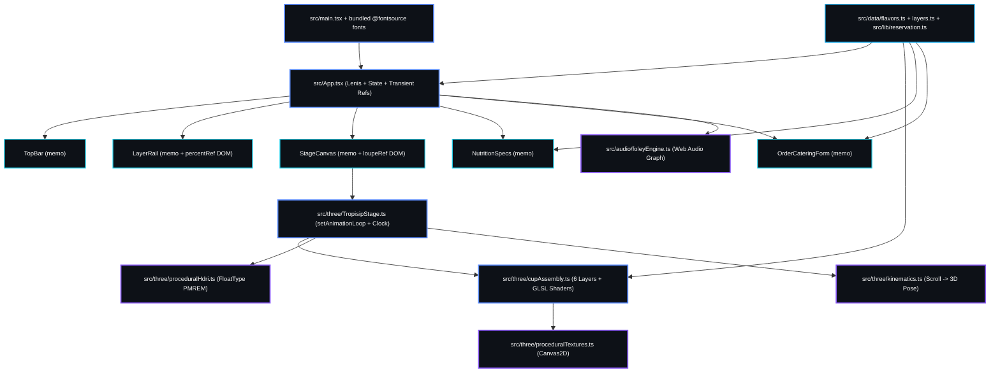

# System Architecture — Tropisip (`corporate/tropisip`)

## 1. Architectural Overview

`corporate/tropisip` is a self-contained **client-side Single Page Application (SPA)** built with Vite 6, React 19, TypeScript 5.9, Three.js 0.175, Lenis 1.3, and the native Web Audio API. It has **no backend server, no database, no external API calls, and zero external runtime media assets**.

All fonts (`@fontsource/poppins`, `@fontsource/jetbrains-mono`) are bundled directly into `dist/assets/` at build time. All 3D meshes, textures, studio HDRI lighting probes, and ASMR sound effects are generated procedurally in browser memory at runtime.

## 2. Entrypoints & Module Topology

- **HTML Shell:** `index.html` (`lang="id"`, mounts `#root` and loads `/src/main.tsx`).
- **Bootstrap Entrypoint:** `src/main.tsx` imports bundled font weights (`Poppins` 400–800, `JetBrains Mono` 400–600), `src/styles/editorial.css`, and mounts `<App />` inside `React.StrictMode`.
- **Orchestrator:** `src/App.tsx` owns Lenis smooth scroll, `TropisipFoleyEngine` lifecycle, active flavor/size/macro/audio state, keyboard shortcuts (`M`, `Escape`), and scroll chapter synchronization.

## 3. Procedural WebGL Pipeline (`src/three/`)

### A. Sunlit Studio Environment (`src/three/proceduralHdri.ts`)
`createSunlitStudioEnvMap(renderer)` synthesizes a `512×256` `THREE.FloatType` equirectangular `DataTexture` representing an overhead sunlit atrium softbox, Classic Linen floor bounce, dual vertical studio rim strips, and subtle dappled canopy modulation, then compiles it via `THREE.PMREMGenerator.fromEquirectangular(...)` and disposes intermediate textures immediately.

### B. 6-Layer Cup Assembly (`src/three/cupAssembly.ts`)
`TropisipCupAssembly` constructs six independent `THREE.Group` subtrees tagged with `userData.layerKey` and `userData.feature` for raycast macro telemetry:
1. `domedLid`: Clear PET `LatheGeometry` dome, 95mm snap-collar torus rims, and angled Brunswick Green straw.
2. `ppCup`: Tapered clear PP vessel with Canvas2D condensation roughness/bump maps, dual-softbox Fresnel reflection overlay (`STUDIO_SPECULAR_SHELL_FRAGMENT`), front-aligned (`rotateY(Math.PI)`) 2K Tropisip silkscreen emblem cylinder, and `420` instanced refractive water droplets (`DROPLET_FRAGMENT_SHADER`).
3. `juiceCore`: Full-height `LatheGeometry` core with domain-warped 5-octave FBM pulp shader (`JUICE_FRAGMENT_SHADER`), trapped wall micro-bubbles, top fruit froth collar, vertical chocolate glaze wall-drizzles for Avocado (`uSwirlStrength`), obsidian pitaya micro-seeds (`uSeedDensity`), plus `420` `DynamicDrawUsage` instanced suspended pulp particles.
4. `fruitChunks`: Six flavor-specific procedural fruit fleets (scored cubes, extruded avocado crescents, triangular rind-backed watermelon wedges) with procedural Canvas2D fruit-flesh albedo/bump textures cross-scaled smoothly on flavor switch.
5. `iceInfusion`: `28` displaced dodecahedral crushed ice crystals, `6` curved botanical mint leaves with procedural venation textures, and `110` hydrated chia seeds (dark kernel + translucent mucilage halo).
6. `baseGrip`: Clear frosted stepped PP cup foot with `28` translucent fluted grip ribs and a soft radial ambient-occlusion contact shadow disc.

### C. Dual-Camera 2.6× Optical Macro Pass (`src/three/TropisipStage.ts`)
- Main render loop uses `renderer.setAnimationLoop(this.tick)` driven by `THREE.Clock.getDelta()`, respects `prefers-reduced-motion: reduce`, caps DPR to `Math.min(devicePixelRatio, 2)`, and uses pre-allocated scratch `Vector3`/`Color` fields for **zero per-frame heap allocations**.
- When `macroEnabled` is active, a dedicated secondary `PerspectiveCamera` with `MACRO_FOV = 2 * atan(tan(34° / 2) / 2.6)` focuses on the cursor's raycast hit point on `cup.root`, renders into a `384×384` `WebGLRenderTarget`, flips Y into the circular loupe `<canvas>`, and emits telemetry via O(1) `LAYER_BY_KEY.get(...)` only when inspected values change.
- Unmounting calls `renderer.setAnimationLoop(null)`, recursive `disposeObjectTree(this.scene)`, `envMap.dispose()`, `macroRT.dispose()`, `renderer.dispose()`, and `renderer.forceContextLoss?.()`.

## 4. Control Flow & Performance Boundaries

- **Scroll Synchronization:** `App.tsx` connects Lenis wheel/touch scrolling to `scrollProgressRef.current`, updates `LayerRail`'s percentage span directly via `percentRef.current.textContent`, feeds scroll velocity into `TropisipFoleyEngine.onScroll(...)`, and triggers React state updates **only** when `activeLayerIndex` crosses a chapter boundary (`-1` or `0..5`).
- **Pointer Tracking:** `StageCanvas.tsx` tracks `pointermove` via passive listener and updates `loupeRef.current.style.transform` directly in DOM when `macroEnabledRef.current` is true—eliminating high-frequency React re-renders.
- **Trust Boundary:** The entire runtime executes untrusted client-side browser code with zero privileged credentials, zero server endpoints, and zero cross-origin asset fetches.

## 5. Build Output & Chunk Boundaries

`vite.config.ts` compiles ES2022 bundles into `dist/` with explicit manual chunks:
- `three-*.js` (~513 kB raw / ~131 kB gzip) — Three.js core WebGL engine
- `lenis-*.js` (~18.8 kB raw / ~5.4 kB gzip) — Lenis smooth scroll
- `index-*.js` (~317 kB raw / ~100 kB gzip) — React 19 runtime + Tropisip application code
- `index-*.css` (~64 kB raw / ~27 kB gzip) + self-hosted `.woff`/`.woff2` font files
